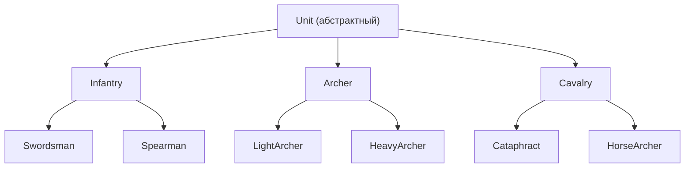
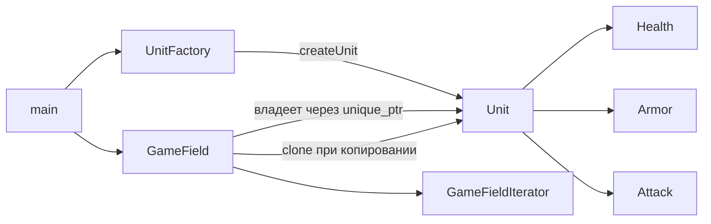

# ООП-лаба: игровое поле и юниты

> [!abstract] Что вообще надо сделать
> Есть игровое поле (сетка клеток). На нём стоят юниты: мечники, лучники, конница. Надо написать классы так, чтобы:
> - поле умело хранить юнитов, не пускало за свои границы и не давало поставить больше лимита;
> - поле можно было **копировать** (чтобы юниты тоже скопировались, а не только ссылки на них) и **перемещать**;
> - по всем юнитам на поле можно было пройтись обычным циклом (для этого нужен **итератор**);
> - юнитов создавала **фабрика**, а не мы вручную через `new`.

---

## Что требуется?

### Поле (`GameField`)

- [ ] Создаётся **любого размера** (ширина, высота)
- [ ] Есть **лимит юнитов** на всём поле
- [ ] Юнитов можно **добавлять и удалять** (по координатам или по индексу)
- [ ] **Глубокое копирование** вместе с юнитами
- [ ] **Перемещение** (конструктор и оператор перемещения)
- [ ] **Итератор**, чтобы обходить юнитов

### Юниты (`Unit`)

- [ ] Общий **абстрактный** базовый класс
- [ ] **3 типа**, у каждого **2 вида**
- [ ] Характеристики: здоровье, броня, атака (можно ещё скорость и дальность)
- [ ] Юнит умеет **перемещаться**, но только внутри поля

> [!info] Иерархия юнитов
> | Тип | Вид 1 | Вид 2 |
> |---|---|---|
> | 🗡️ Пехота (`Infantry`) | Мечник (`Swordsman`) | Копейщик (`Spearman`) |
> | 🏹 Лучники (`Archer`) | Лёгкий (`LightArcher`) | Тяжёлый (`HeavyArcher`) |
> | 🐎 Конница (`Cavalry`) | Катафракт (`Cataphract`) | Конный лучник (`HorseArcher`) |



###  Классы-характеристики

| Класс | Что умеет |
|---|---|
| **`Health`** | `decrease(amount)`, `increase(amount)`, `isZero()`. Здоровье не уходит ниже нуля |
| **`Armor`** | `reduceDamage(damage)`: вычитает броню из урона |
| **`Attack`** | `calculateDamage(targetArmor)`: считает урон по цели с учётом её брони |

### Паттерн, итератор, C++

- [ ] Юнитов создаёт **фабрика** (фабричный метод или абстрактная фабрика). Выбор надо **обосновать**
- [ ] Итератор: `operator*`, `operator++`, `begin()` / `end()`
- [ ] **Правило пяти** для `GameField` (деструктор, копирующие и перемещающие конструктор и присваивание)
- [ ] Константные ссылки везде, где можно
- [ ] **Не меньше 3 демонстрационных сценариев**

---

## Карта проекта

| Файл | Что в нём |
|---|---|
| `UnitType.h` | перечисление видов юнитов и функция `toString` |
| `Health.h/.cpp`, `Armor.h/.cpp`, `Attack.h/.cpp` | характеристики юнита |
| `Unit.h/.cpp` | абстрактный базовый класс юнита |
| `Infantry.h`, `Archer.h`, `Cavalry.h` | типы юнитов и их виды (по два на каждый тип) |
| `UnitFactory.h` | абстрактная фабрика-создатель |
| `ConcreteFactories.h` | три настоящие фабрики |
| `GameFieldIterator.h` | итератор по юнитам |
| `GameField.h/.cpp` | игровое поле |
| `main.cpp` | консольная игра: рисует поле, меню, три сценария |

---

## Этапы проекта

---

###  Этап 1. Проектирование и создание основы классов

- [ ] **Создать заголовочные и исходные файлы для каждого будущего класса**

**Что такое `.h` и `.cpp`.** В `.h` пишем «что класс умеет» (объявления), в `.cpp` пишем «как он это делает» (реализации). Когда в файле написано `#include "GameField.h"`, компилятор просто вставляет туда текст этого заголовка.

```text
lab_gamefield/
├── UnitType.h
├── Health.h   Health.cpp
├── Armor.h    Armor.cpp
├── Attack.h   Attack.cpp
├── Unit.h     Unit.cpp
├── Infantry.h              (Infantry + Swordsman + Spearman)
├── Archer.h                (Archer + LightArcher + HeavyArcher)
├── Cavalry.h               (Cavalry + Cataphract + HorseArcher)
├── UnitFactory.h
├── ConcreteFactories.h
├── GameFieldIterator.h
├── GameField.h  GameField.cpp
└── main.cpp
```

Каждый заголовок начинается с одной и той же строки:

```cpp
#pragma once
```

> [!tip] Тонкости
> - **`#pragma once`** защищает от двойного подключения. Один заголовок может прийти в файл по двум путям (например, `GameField.h` подключает `Unit.h`, и `main.cpp` тоже подключает `Unit.h`). Без защиты компилятор увидит класс дважды и выдаст ошибку «redefinition».
> - В команде сборки только `.cpp`. Заголовки туда не пишем, они и так подключаются через `#include`.
> - Компилятор собирает каждый `.cpp` отдельно, а потом **линковщик** склеивает всё в один `.exe`. Поэтому функция `main` должна быть ровно в одном `.cpp`.
> - Флаг `-std=c++17` нужен, потому что в коде есть `std::is_abstract_v` и другие вещи из C++17. В Visual Studio это включается в свойствах проекта (см. в конце заметки).

---

- [ ] **Спроектировать и определить абстрактный базовый класс Unit с чисто виртуальными методами**

Сначала перечисление видов юнитов, оно понадобится и юнитам, и фабрикам:

```cpp
#pragma once

enum class UnitType {
    Swordsman, Spearman,
    LightArcher, HeavyArcher,
    Cataphract, HorseArcher
};

inline const char* toString(UnitType type) {
    switch (type) {
        case UnitType::Swordsman: return "Swordsman";
        case UnitType::Spearman: return "Spearman";
        case UnitType::LightArcher: return "LightArcher";
        case UnitType::HeavyArcher: return "HeavyArcher";
        case UnitType::Cataphract: return "Cataphract";
        case UnitType::HorseArcher: return "HorseArcher";
    }
    return "Unknown";
}
```
Теперь сам `Unit`. Здесь только то, что нужно знать снаружи. Реализацию методов напишем на втором этапе.

```cpp
#pragma once
#include <memory>
#include "Health.h"
#include "Armor.h"
#include "Attack.h"
#include "UnitType.h"

class Unit {
public:
    Unit(const Health& health, const Armor& armor, const Attack& attack, int x, int y);
    virtual ~Unit() = default;

    Unit(const Unit&) = default;
    Unit& operator=(const Unit&) = default;

    virtual std::unique_ptr<Unit> clone() const = 0;
    virtual UnitType getType() const = 0;

    const Health& health() const { return health_; }
    const Armor& armor() const { return armor_; }
    const Attack& attack() const { return attack_; }
    int x() const { return x_; }
    int y() const { return y_; }

    bool moveTo(int newX, int newY, int fieldWidth, int fieldHeight);
    void takeDamage(int rawDamage);
    bool isAlive() const;
    int calcDamageTo(const Unit& target) const;

protected:
    Health health_;
    Armor armor_;
    Attack attack_;
    int x_;
    int y_;
};
```

---

- [ ] **Спроектировать классы-атрибуты Health, Armor, Attack с необходимыми методами и инкапсуляцией**

Пока только объявления. Реализации будут на втором этапе.

```cpp
#pragma once

class Health {
public:
    explicit Health(int value);
    int value() const;
    void decrease(int amount);
    void increase(int amount);
    bool isZero() const;
private:
    int value_;
};
```

```cpp
#pragma once

class Armor {
public:
    explicit Armor(int value);
    int value() const;
    int reduceDamage(int damage) const;
private:
    int value_;
};
```

```cpp
#pragma once
#include "Armor.h"

class Attack {
public:
    explicit Attack(int value);
    int value() const;
    int calculateDamage(const Armor& targetArmor) const;
private:
    int value_;
};
```

---

- [ ] **Определить базовый интерфейс фабрики UnitFactory**

```cpp
#pragma once
#include <memory>
#include "Unit.h"

class UnitFactory {
public:
    virtual ~UnitFactory() = default;
    virtual std::unique_ptr<Unit> createUnit(UnitType type, int x, int y) const = 0;
};
```

---

- [ ] **Определить класс GameField с базовым набором методов и членов данных**

```cpp
#pragma once
#include <cstddef>
#include <memory>
#include <vector>
#include "GameFieldIterator.h"
#include "Unit.h"
#include "UnitFactory.h"

class GameField {
public:
    using iterator = GameFieldIterator;
    using const_iterator = ConstGameFieldIterator;

    GameField(int width, int height, std::size_t maxUnits);

    ~GameField();
    GameField(const GameField& other);
    GameField& operator=(const GameField& other);
    GameField(GameField&& other) noexcept;
    GameField& operator=(GameField&& other) noexcept;

    bool addUnit(std::unique_ptr<Unit> unit);
    bool addUnit(const UnitFactory& factory, UnitType type, int x, int y);
    bool removeUnit(int x, int y);
    bool removeByIndex(std::size_t cellIndex);
    bool moveUnit(int fromX, int fromY, int toX, int toY);
    Unit* getUnit(int x, int y);
    const Unit* getUnit(int x, int y) const;

    std::size_t size() const;
    bool empty() const;
    void clear();
    int width() const;
    int height() const;
    std::size_t maxUnits() const;

    iterator begin();
    iterator end();
    const_iterator begin() const;
    const_iterator end() const;

private:
    bool inBounds(int x, int y) const;
    std::size_t index(int x, int y) const;

    int width_;
    int height_;
    std::size_t maxUnits_;
    std::size_t count_;
    std::vector<std::unique_ptr<Unit>> cells_;
};
```

---

### Этап 2. Реализация классов атрибутов и иерархии юнитов

- [ ] **Реализовать Health, Armor, Attack с валидацией и логикой (decrease, increase, isZero, reduceDamage, calculateDamage)**

```cpp
#include "Health.h"
#include <stdexcept>

Health::Health(int value) : value_(value) {
    if (value < 0)
        throw std::invalid_argument("Health: значение не может быть отрицательным");
}

int Health::value() const { return value_; }

void Health::decrease(int amount) {
    if (amount < 0)
        throw std::invalid_argument("Health::decrease: amount < 0");
    value_ = (amount >= value_) ? 0 : value_ - amount;
}

void Health::increase(int amount) {
    if (amount < 0)
        throw std::invalid_argument("Health::increase: amount < 0");
    value_ += amount;
}

bool Health::isZero() const { return value_ == 0; }
```

```cpp
#include "Armor.h"
#include <stdexcept>

Armor::Armor(int value) : value_(value) {
    if (value < 0)
        throw std::invalid_argument("Armor: значение не может быть отрицательным");
}

int Armor::value() const { return value_; }

int Armor::reduceDamage(int damage) const {
    if (damage < 0)
        throw std::invalid_argument("Armor::reduceDamage: damage < 0");
    return damage > value_ ? damage - value_ : 0;
}
```

```cpp
#include "Attack.h"
#include <stdexcept>

Attack::Attack(int value) : value_(value) {
    if (value < 0)
        throw std::invalid_argument("Attack: значение не может быть отрицательным");
}

int Attack::value() const { return value_; }

int Attack::calculateDamage(const Armor& targetArmor) const {
    return targetArmor.reduceDamage(value_);
}
```

---

- [ ] **Реализовать абстрактный класс Unit с общими методами (геттеры, move, координаты)**

Геттеры уже написаны прямо в заголовке. Остальное здесь:

```cpp
#include "Unit.h"

Unit::Unit(const Health& health, const Armor& armor, const Attack& attack, int x, int y)
    : health_(health), armor_(armor), attack_(attack), x_(x), y_(y) {}

bool Unit::moveTo(int newX, int newY, int fieldWidth, int fieldHeight) {
    if (newX < 0 || newY < 0 || newX >= fieldWidth || newY >= fieldHeight)
        return false;
    x_ = newX;
    y_ = newY;
    return true;
}

void Unit::takeDamage(int rawDamage) {
    health_.decrease(armor_.reduceDamage(rawDamage));
}

bool Unit::isAlive() const { return !health_.isZero(); }

int Unit::calcDamageTo(const Unit& target) const {
    return attack_.calculateDamage(target.armor_);
}
```

---

- [ ] **Создать 3 типа юнитов (Infantry, Archer, Cavalry) как промежуточные абстрактные классы**

Это начало трёх заголовков: `Infantry.h`, `Archer.h`, `Cavalry.h`. Они наследуют `Unit`, но `clone()` и `getType()` **не** реализуют, поэтому тоже остаются абстрактными. Дополнительные атрибуты (дальность, скорость) живут здесь.

```cpp
class Infantry : public Unit {
public:
    Infantry(const Health& h, const Armor& a, const Attack& at, int x, int y)
        : Unit(h, a, at, x, y) {}
};
```

```cpp
class Archer : public Unit {
public:
    Archer(const Health& h, const Armor& a, const Attack& at, int x, int y, int range)
        : Unit(h, a, at, x, y), range_(range) {}
    int range() const { return range_; }
private:
    int range_;
};
```

```cpp
class Cavalry : public Unit {
public:
    Cavalry(const Health& h, const Armor& a, const Attack& at, int x, int y, int speed)
        : Unit(h, a, at, x, y), speed_(speed) {}
    int speed() const { return speed_; }
private:
    int speed_;
};
```

---

- [ ] **Для каждого типа создать по 2 конкретных вида (Swordsman/Spearman, LightArcher/HeavyArcher, Cataphract/HorseArcher)**

Конкретный юнит отличается от соседа только числами, которые передаёт вверх по цепочке конструкторов. Пример:

```cpp
class Swordsman : public Infantry {
public:
    Swordsman(int x, int y) : Infantry(Health(100), Armor(5), Attack(15), x, y) {}
};
```

Цепочка такая: `Swordsman(x, y)` вызывает `Infantry(...)`, тот вызывает `Unit(...)`. Снаружи достаточно указать только координаты.

| Класс | Health | Armor | Attack | Доп. атрибут |
|---|---|---|---|---|
| `Swordsman` | 100 | 5 | 15 | нет |
| `Spearman` | 90 | 4 | 12 | нет |
| `LightArcher` | 60 | 1 | 14 | range = 6 |
| `HeavyArcher` | 80 | 3 | 18 | range = 5 |
| `Cataphract` | 150 | 8 | 20 | speed = 3 |
| `HorseArcher` | 90 | 2 | 16 | speed = 5 |

---

- [ ] **Реализовать в каждом конкретном классе методы clone() и getType()**

Итоговые файлы. Сверху промежуточный класс, ниже его виды.

```cpp
#pragma once
#include "Unit.h"

class Infantry : public Unit {
public:
    Infantry(const Health& h, const Armor& a, const Attack& at, int x, int y)
        : Unit(h, a, at, x, y) {}
};

class Swordsman : public Infantry {
public:
    Swordsman(int x, int y) : Infantry(Health(100), Armor(5), Attack(15), x, y) {}
    std::unique_ptr<Unit> clone() const override { return std::make_unique<Swordsman>(*this); }
    UnitType getType() const override { return UnitType::Swordsman; }
};

class Spearman : public Infantry {
public:
    Spearman(int x, int y) : Infantry(Health(90), Armor(4), Attack(12), x, y) {}
    std::unique_ptr<Unit> clone() const override { return std::make_unique<Spearman>(*this); }
    UnitType getType() const override { return UnitType::Spearman; }
};
```

```cpp
#pragma once
#include "Unit.h"

class Archer : public Unit {
public:
    Archer(const Health& h, const Armor& a, const Attack& at, int x, int y, int range)
        : Unit(h, a, at, x, y), range_(range) {}
    int range() const { return range_; }
private:
    int range_;
};

class LightArcher : public Archer {
public:
    LightArcher(int x, int y) : Archer(Health(60), Armor(1), Attack(14), x, y, 6) {}
    std::unique_ptr<Unit> clone() const override { return std::make_unique<LightArcher>(*this); }
    UnitType getType() const override { return UnitType::LightArcher; }
};

class HeavyArcher : public Archer {
public:
    HeavyArcher(int x, int y) : Archer(Health(80), Armor(3), Attack(18), x, y, 5) {}
    std::unique_ptr<Unit> clone() const override { return std::make_unique<HeavyArcher>(*this); }
    UnitType getType() const override { return UnitType::HeavyArcher; }
};
```

```cpp
#pragma once
#include "Unit.h"

class Cavalry : public Unit {
public:
    Cavalry(const Health& h, const Armor& a, const Attack& at, int x, int y, int speed)
        : Unit(h, a, at, x, y), speed_(speed) {}
    int speed() const { return speed_; }
private:
    int speed_;
};

class Cataphract : public Cavalry {
public:
    Cataphract(int x, int y) : Cavalry(Health(150), Armor(8), Attack(20), x, y, 3) {}
    std::unique_ptr<Unit> clone() const override { return std::make_unique<Cataphract>(*this); }
    UnitType getType() const override { return UnitType::Cataphract; }
};

class HorseArcher : public Cavalry {
public:
    HorseArcher(int x, int y) : Cavalry(Health(90), Armor(2), Attack(16), x, y, 5) {}
    std::unique_ptr<Unit> clone() const override { return std::make_unique<HorseArcher>(*this); }
    UnitType getType() const override { return UnitType::HorseArcher; }
};
```

---

### Этап 3. Паттерн «Фабричный метод» / «Абстрактная фабрика»

- [ ] **Реализовать абстрактный класс UnitFactory с методом createUnit(...)**

Он уже написан на первом этапе (`UnitFactory.h`). Это и есть «создатель» из паттерна: объявляет метод `createUnit`, а наследники решают, что создавать.

---

- [ ] **Создать конкретные фабрики (InfantryFactory, ArcherFactory, CavalryFactory) либо семейства фабрик (NorthArmyFactory, SouthArmyFactory)**

```cpp
#pragma once

#include <stdexcept>
#include "UnitFactory.h"
#include "Infantry.h"
#include "Archer.h"
#include "Cavalry.h"

// Выбран фабричный метод: юниты делятся на три типа, а семейств
// (вроде "армия севера" и "армия юга") нет, поэтому абстрактная фабрика не нужна.
// Новый вид юнита добавляется новой фабрикой, GameField при этом не меняется.

class InfantryFactory : public UnitFactory {
public:
    std::unique_ptr<Unit> createUnit(UnitType type, int x, int y) const override {
        switch (type) {
            case UnitType::Swordsman: return std::make_unique<Swordsman>(x, y);
            case UnitType::Spearman: return std::make_unique<Spearman>(x, y);
            default:
                throw std::invalid_argument("InfantryFactory: это не пехота");
        }
    }
};

class ArcherFactory : public UnitFactory {
public:
    std::unique_ptr<Unit> createUnit(UnitType type, int x, int y) const override {
        switch (type) {
            case UnitType::LightArcher: return std::make_unique<LightArcher>(x, y);
            case UnitType::HeavyArcher: return std::make_unique<HeavyArcher>(x, y);
            default:
                throw std::invalid_argument("ArcherFactory: это не лучник");
        }
    }
};

class CavalryFactory : public UnitFactory {
public:
    std::unique_ptr<Unit> createUnit(UnitType type, int x, int y) const override {
        switch (type) {
            case UnitType::Cataphract: return std::make_unique<Cataphract>(x, y);
            case UnitType::HorseArcher: return std::make_unique<HorseArcher>(x, y);
            default:
                throw std::invalid_argument("CavalryFactory: это не конница");
        }
    }
};
```

---

- [ ] **Обосновать выбор паттерна в комментариях/README**

Короткая версия уже в `ConcreteFactories.h`. Для README можно взять так:

```markdown
Выбранный паттерн: фабричный метод

- Юниты делятся на три типа (пехота, лучники, конница), но не образуют «семейств»
  вроде «армия севера» и «армия юга».
- Новый вид юнита добавляется новой фабрикой и новым классом, а уже написанный код не трогаем.
- Создание юнитов собрано в одном месте.
```

---

- [ ] **Переписать демонстрационный код так, чтобы юниты создавались только через фабрики**

В `main.cpp` есть маленькая функция, которая по виду юнита выдаёт нужную фабрику:

```cpp
const int kMaxWidth = 35;
const int kMaxHeight = 40;
const int kFrameDelay = 400;

const UnitType kAllTypes[6] = {
    UnitType::Swordsman, UnitType::Spearman,
    UnitType::LightArcher, UnitType::HeavyArcher,
    UnitType::Cataphract, UnitType::HorseArcher
};

const UnitFactory& factoryFor(UnitType type) {
    static InfantryFactory infantry;
    static ArcherFactory archers;
    static CavalryFactory cavalry;
    switch (type) {
    case UnitType::Swordsman:
    case UnitType::Spearman: return infantry;
    case UnitType::LightArcher:
    case UnitType::HeavyArcher: return archers;
    default: return cavalry;
    }
}

UnitType randomType() { return kAllTypes[std::rand() % 6]; }
```

---

- [ ] **Добавить в GameField возможность принимать UnitFactory для наполнения поля**

Это вторая версия `addUnit`. Она берёт фабрику и просит её создать юнита:

```cpp
bool GameField::addUnit(std::unique_ptr<Unit> unit) {
    if (!unit) return false;
    if (count_ >= maxUnits_) return false;
    if (!inBounds(unit->x(), unit->y())) return false;

    auto& cell = cells_[index(unit->x(), unit->y())];
    if (cell) return false;

    cell = std::move(unit);
    ++count_;
    return true;
}

bool GameField::addUnit(const UnitFactory& factory, UnitType type, int x, int y) {
    return addUnit(factory.createUnit(type, x, y));
}
```

---

### Этап 4. Реализация класса GameField и итератора

- [ ] **Реализовать базовые операции (addUnit, removeUnit, getUnit, size, empty, clear) с проверкой границ и лимита maxUnits**

```cpp
GameField::GameField(int width, int height, std::size_t maxUnits)
    : width_(width), height_(height), maxUnits_(maxUnits), count_(0) {
    if (width <= 0 || height <= 0)
        throw std::invalid_argument("GameField: размеры поля должны быть > 0");
    cells_.resize(static_cast<std::size_t>(width) * static_cast<std::size_t>(height));
}

GameField::~GameField() = default;

bool GameField::inBounds(int x, int y) const {
    return x >= 0 && y >= 0 && x < width_ && y < height_;
}

std::size_t GameField::index(int x, int y) const {
    return static_cast<std::size_t>(y) * static_cast<std::size_t>(width_)
         + static_cast<std::size_t>(x);
}

bool GameField::addUnit(std::unique_ptr<Unit> unit) {
    if (!unit) return false;
    if (count_ >= maxUnits_) return false;
    if (!inBounds(unit->x(), unit->y())) return false;

    auto& cell = cells_[index(unit->x(), unit->y())];
    if (cell) return false;

    cell = std::move(unit);
    ++count_;
    return true;
}

bool GameField::removeUnit(int x, int y) {
    if (!inBounds(x, y)) return false;
    auto& cell = cells_[index(x, y)];
    if (!cell) return false;
    cell.reset();
    --count_;
    return true;
}

bool GameField::removeByIndex(std::size_t cellIndex) {
    if (cellIndex >= cells_.size() || !cells_[cellIndex]) return false;
    cells_[cellIndex].reset();
    --count_;
    return true;
}

Unit* GameField::getUnit(int x, int y) {
    return inBounds(x, y) ? cells_[index(x, y)].get() : nullptr;
}

const Unit* GameField::getUnit(int x, int y) const {
    return inBounds(x, y) ? cells_[index(x, y)].get() : nullptr;
}

bool GameField::moveUnit(int fromX, int fromY, int toX, int toY) {
    if (!inBounds(fromX, fromY) || !inBounds(toX, toY)) return false;
    auto& from = cells_[index(fromX, fromY)];
    auto& to = cells_[index(toX, toY)];
    if (!from || to) return false;
    from->moveTo(toX, toY, width_, height_);
    to = std::move(from);
    return true;
}

std::size_t GameField::size() const { return count_; }

bool GameField::empty() const { return count_ == 0; }

int GameField::width() const { return width_; }

int GameField::height() const { return height_; }

std::size_t GameField::maxUnits() const { return maxUnits_; }

void GameField::clear() {
    for (auto& cell : cells_) cell.reset();
    count_ = 0;
}
```

---

- [ ] **Реализовать глубокое копирование (конструктор копирования и оператор присваивания с clone() каждого юнита)**

```cpp
GameField::GameField(const GameField& other)
    : width_(other.width_), height_(other.height_),
      maxUnits_(other.maxUnits_), count_(other.count_) {
    cells_.reserve(other.cells_.size());
    for (const auto& cell : other.cells_) {
        if (cell) cells_.push_back(cell->clone()); // копируем самих юнитов, а не указатели
        else cells_.push_back(nullptr);
    }
}

GameField& GameField::operator=(const GameField& other) {
    if (this != &other) {
        GameField copy(other);
        *this = std::move(copy);
    }
    return *this;
}
```

**Мелкое и глубокое копирование на пальцах.** Если просто скопировать указатели, у двух полей окажутся ссылки на **одних и тех же** юнитов. Тогда ранили юнита в копии, и он ранен в оригинале. Это мелкое копирование, и оно нам не подходит. Глубокое значит: для каждого юнита создаём **нового** юнита-двойника. Так копия живёт сама по себе.

---

- [ ] **Реализовать семантику перемещения (конструктор перемещения и оператор присваивания перемещением — для C++)**

```cpp
GameField::GameField(GameField&& other) noexcept
    : width_(other.width_), height_(other.height_),
      maxUnits_(other.maxUnits_), count_(other.count_),
      cells_(std::move(other.cells_)) {
    other.width_ = 0;
    other.height_ = 0;
    other.maxUnits_ = 0;
    other.count_ = 0;
    other.cells_.clear();
}

GameField& GameField::operator=(GameField&& other) noexcept {
    if (this != &other) {
        width_ = other.width_;
        height_ = other.height_;
        maxUnits_ = other.maxUnits_;
        count_ = other.count_;
        cells_ = std::move(other.cells_);

        other.width_ = 0;
        other.height_ = 0;
        other.maxUnits_ = 0;
        other.count_ = 0;
        other.cells_.clear();
    }
    return *this;
}
```

**Копирование и перемещение, разница.** Копирование делает второго такого же. Перемещение **забирает** содержимое у старого объекта и отдаёт новому. Юнитов никто не копирует: вектор просто передаёт свой внутренний буфер, поэтому это очень быстро.

---

- [ ] **Реализовать собственный итератор (GameFieldIterator с operator\*/operator++) для обхода только непустых ячеек с юнитами**

```cpp
#pragma once
#include <cstddef>
#include <iterator>
#include <memory>
#include <type_traits>
#include <vector>
#include "Unit.h"

template <bool IsConst>
class GameFieldIteratorT {
    using Cells = std::vector<std::unique_ptr<Unit>>;
    using CellIt = std::conditional_t<IsConst, Cells::const_iterator, Cells::iterator>;

public:
    using iterator_category = std::forward_iterator_tag;
    using value_type = Unit;
    using difference_type = std::ptrdiff_t;
    using pointer = std::conditional_t<IsConst, const Unit*, Unit*>;
    using reference = std::conditional_t<IsConst, const Unit&, Unit&>;

    GameFieldIteratorT(CellIt current, CellIt end) : current_(current), end_(end) {
        skipEmpty();
    }

    reference operator*() const { return **current_; }
    pointer operator->() const { return current_->get(); }

    GameFieldIteratorT& operator++() {
        ++current_;
        skipEmpty();
        return *this;
    }
    GameFieldIteratorT operator++(int) {
        GameFieldIteratorT tmp = *this;
        ++(*this);
        return tmp;
    }

    bool operator==(const GameFieldIteratorT& other) const { return current_ == other.current_; }
    bool operator!=(const GameFieldIteratorT& other) const { return !(*this == other); }

private:
    void skipEmpty() {
        while (current_ != end_ && !*current_) ++current_;
    }

    CellIt current_;
    CellIt end_;
};

using GameFieldIterator = GameFieldIteratorT<false>;
using ConstGameFieldIterator = GameFieldIteratorT<true>;
```
И методы `begin()` и `end()` в поле:

```cpp
GameField::iterator GameField::begin() { return iterator(cells_.begin(), cells_.end()); }

GameField::iterator GameField::end() { return iterator(cells_.end(), cells_.end()); }

GameField::const_iterator GameField::begin() const { return const_iterator(cells_.begin(), cells_.end()); }

GameField::const_iterator GameField::end() const { return const_iterator(cells_.end(), cells_.end()); }
```

**Как это работает.** Итератор это «стрелочка», которая показывает на текущего юнита. Он **оборачивает** итератор обычного вектора и сам перепрыгивает пустые клетки. Поэтому снаружи видны только юниты.

---

### Этап 5. Тестирование, демонстрация и документирование

Вся демонстрация это консольная «игра» в `Osobo Opasniy Prestupnik #1.cpp`: поле в рамке из `X`, справа меню с действиями. Юниты рисуются буквами: `M` мечник, `K` копейщик, `L` лёгкий лучник, `T` тяжёлый лучник, `C` катафракт, `H` конный лучник. Погибший юнит рисуется строчной буквой.

- [ ] **Реализовать не менее 3 демонстрационных сценариев**

Сначала разберёмся, как программа устроена, а потом сами сценарии.

#### Как рисуется поле

```cpp
char symbolOf(UnitType type) {
    switch (type) {
    case UnitType::Swordsman: return 'M';
    case UnitType::Spearman: return 'K';
    case UnitType::LightArcher: return 'L';
    case UnitType::HeavyArcher: return 'T';
    case UnitType::Cataphract: return 'C';
    case UnitType::HorseArcher: return 'H';
    }
    return '?';
}

char unitSymbol(const Unit& u) {
    char c = symbolOf(u.getType());
    return u.isAlive() ? c : static_cast<char>(std::tolower(static_cast<unsigned char>(c)));
}

std::vector<std::string> renderField(const GameField& field) {
    std::vector<std::string> lines;

    std::string border;
    for (int i = 0; i < field.width() + 2; ++i) {
        border += 'X';
        if (i < field.width() + 1) border += ' ';
    }

    lines.push_back(border);
    for (int y = 0; y < field.height(); ++y) {
        std::string row = "X ";
        for (int x = 0; x < field.width(); ++x) {
            const Unit* u = field.getUnit(x, y);
            row += u ? unitSymbol(*u) : ' ';
            row += ' ';
        }
        row += 'X';
        lines.push_back(row);
    }
    lines.push_back(border);
    return lines;
}

std::vector<std::string> menuLines() {
    return {
        "ОСНОВНОЙ ФУНКЦИОНАЛ:",
        "1. Добавить юнита (фабрика)",
        "2. Удалить юнита (x, y)",
        "3. Удалить юнита (индекс ячейки)",
        "4. Переместить юнита",
        "5. Информация о юните",
        "6. Нанести урон юниту",
        "7. Атака: юнит бьёт юнита",
        "8. Массовый урон всем (итератор)",
        "9. Убрать погибших (итератор)",
        "10. Список юнитов (итератор)",
        "ПРОЧИЙ ФУНКЦИОНАЛ:",
        "11. Случайная армия (фабрики)",
        "12. Очистить поле",
        "13. Сценарий 1: ядерный удар",
        "14. Сценарий 2: местная междоусобица",
        "15. Сценарий 3: типовая мировая война",
        "16. Создать новое поле",
        "0. Выход"
    };
}

void clearScreen() {
#ifdef _WIN32
    std::system("cls");
#else
    std::system("clear");
#endif
}

void drawScreen(const GameField& field, const std::string& message) {
    clearScreen();

    std::vector<std::string> left = renderField(field);
    std::vector<std::string> right = menuLines();
    std::size_t leftWidth = left.empty() ? 0 : left[0].size();
    std::size_t rows = std::max(left.size(), right.size());

    for (std::size_t i = 0; i < rows; ++i) {
        std::string l = i < left.size() ? left[i] : std::string();
        l.resize(leftWidth, ' ');
        std::cout << l << "    " << (i < right.size() ? right[i] : std::string()) << "\n";
    }

    std::cout << "Поле " << field.width() << "x" << field.height() << ", юнитов: " << field.size() << "/" << field.maxUnits() << "\n";
    if (!message.empty()) std::cout << ">> " << message << "\n";
}

void showFrame(const GameField& field, const std::string& title) {
    clearScreen();
    std::cout << title << "\n\n";
    for (const std::string& line : renderField(field)) std::cout << line << "\n";
    std::cout << "\nЮнитов: " << field.size() << "/" << field.maxUnits() << "\n";
    std::cout << "\nНажмите Enter, чтобы продолжить...";
    std::string dummy;
    std::getline(std::cin, dummy);
}
```

#### Ввод с клавиатуры

```cpp
int readInt(const std::string& prompt) {
    int value;
    while (true) {
        std::cout << prompt;
        if (std::cin >> value) {
            std::cin.ignore((std::numeric_limits<std::streamsize>::max)(), '\n');
            return value;
        }
        if (std::cin.eof()) std::exit(0);
        std::cin.clear();
        std::cin.ignore((std::numeric_limits<std::streamsize>::max)(), '\n');
        std::cout << "Нужно ввести число.\n";
    }
}

int readIntInRange(const std::string& prompt, int lo, int hi) {
    while (true) {
        int v = readInt(prompt);
        if (v >= lo && v <= hi) return v;
        std::cout << "Введите число от " << lo << " до " << hi << ".\n";
    }
}

void waitEnter() {
    std::cout << "\nНажмите Enter, чтобы продолжить...";
    std::string dummy;
    std::getline(std::cin, dummy);
}
```

#### Действия меню (пункты 1-10)

Добавление, удаление, перемещение:

```cpp
std::string addFailureReason(const GameField& f, int x, int y) {
    if (x < 0 || y < 0 || x >= f.width() || y >= f.height()) return "координаты вне поля";
    if (f.getUnit(x, y)) return "клетка занята";
    if (f.size() >= f.maxUnits()) return "достигнут лимит юнитов";
    return "неизвестная причина";
}

std::string actAdd(GameField& field) {
    std::cout << "\nВиды юнитов:\n";
    for (int i = 0; i < 6; ++i)
        std::cout << "  " << i + 1 << " - " << toString(kAllTypes[i])
        << " [" << symbolOf(kAllTypes[i]) << "]\n";

    int k = readInt("Вид (1-6): ");
    if (k < 1 || k > 6) return "Неверный номер вида юнита.";
    int x = readInt("x: ");
    int y = readInt("y: ");

    UnitType t = kAllTypes[k - 1];
    if (field.addUnit(factoryFor(t), t, x, y))
        return std::string("Добавлен юнит ") + toString(t) + " в (" +
        std::to_string(x) + "," + std::to_string(y) + ").";
    return "Не добавлено: " + addFailureReason(field, x, y) + ".";
}

std::string actRemoveXY(GameField& field) {
    int x = readInt("x: ");
    int y = readInt("y: ");
    return field.removeUnit(x, y) ? "Юнит удалён." : "Там нет юнита (или координаты вне поля).";
}

std::string actRemoveIndex(GameField& field) {
    std::cout << "Индекс ячейки = y * ширина + x (от 0 до "
        << field.width() * field.height() - 1 << ")\n";
    int idx = readInt("Индекс: ");
    if (idx < 0) return "Индекс не может быть отрицательным.";
    return field.removeByIndex(static_cast<std::size_t>(idx))
        ? "Юнит удалён." : "В этой ячейке нет юнита (или индекс вне поля).";
}

std::string actMove(GameField& field) {
    int x1 = readInt("Откуда x: ");
    int y1 = readInt("Откуда y: ");
    int x2 = readInt("Куда x: ");
    int y2 = readInt("Куда y: ");
    return field.moveUnit(x1, y1, x2, y2)
        ? "Юнит перемещён."
        : "Не перемещён: нет юнита в начальной клетке, цель занята или вне поля.";
}
```
Информация, урон, атака:

```cpp
std::string actInfo(const GameField& field) {
    int x = readInt("x: ");
    int y = readInt("y: ");
    const Unit* u = field.getUnit(x, y);
    if (!u) return "Там нет юнита.";

    std::cout << "\nВид: " << toString(u->getType()) << " [" << unitSymbol(*u) << "]\n"
        << "Позиция: (" << u->x() << "," << u->y() << ")\n"
        << "Здоровье: " << u->health().value() << "\n"
        << "Броня: " << u->armor().value() << "\n"
        << "Атака: " << u->attack().value() << "\n";
    if (const Archer* a = dynamic_cast<const Archer*>(u))
        std::cout << "Дальность: " << a->range() << "\n";
    if (const Cavalry* c = dynamic_cast<const Cavalry*>(u))
        std::cout << "Скорость: " << c->speed() << "\n";
    waitEnter();
    return "Информация показана.";
}

std::string actDamage(GameField& field) {
    int x = readInt("x: ");
    int y = readInt("y: ");
    int amount = readInt("Урон (до учёта брони): ");
    Unit* u = field.getUnit(x, y);
    if (!u) return "Там нет юнита.";
    if (amount < 0) return "Урон не может быть отрицательным.";
    int before = u->health().value();
    u->takeDamage(amount);
    return std::string(toString(u->getType())) + ": HP " + std::to_string(before) +
        " -> " + std::to_string(u->health().value()) + ".";
}

std::string actAttack(GameField& field) {
    int x1 = readInt("Атакующий x: ");
    int y1 = readInt("Атакующий y: ");
    int x2 = readInt("Цель x: ");
    int y2 = readInt("Цель y: ");
    Unit* attacker = field.getUnit(x1, y1);
    Unit* target = field.getUnit(x2, y2);
    if (!attacker || !target) return "В одной из клеток нет юнита.";
    if (attacker == target) return "Юнит не может атаковать сам себя.";
    if (!attacker->isAlive()) return "Погибший юнит не может атаковать.";

    int before = target->health().value();
    int dmg = attacker->calcDamageTo(*target);
    target->takeDamage(attacker->attack().value());
    return std::string(toString(attacker->getType())) + " бьёт " + toString(target->getType()) +
        ": урон " + std::to_string(dmg) + ", HP " + std::to_string(before) +
        " -> " + std::to_string(target->health().value()) + ".";
}
```
Итератор в деле (массовый урон, удаление погибших, список):

```cpp
std::string actMassDamage(GameField& field) {
    int amount = readInt("Урон каждому юниту: ");
    if (amount < 0) return "Урон не может быть отрицательным.";
    int count = 0;
    for (Unit& u : field) {
        u.takeDamage(amount);
        ++count;
    }
    return "Урон " + std::to_string(amount) + " нанесён юнитам: " + std::to_string(count) + ".";
}

int removeDead(GameField& field) {
    int removed = 0;
    for (auto it = field.begin(); it != field.end(); ++it) {
        if (!it->isAlive()) {
            field.removeUnit(it->x(), it->y());
            ++removed;
        }
    }
    return removed;
}

std::string actRemoveDead(GameField& field) {
    return "Убрано погибших: " + std::to_string(removeDead(field)) + ".";
}

std::string actList(const GameField& field) {
    std::cout << "\nВсе юниты на поле (" << field.size() << "):\n";
    int n = 0;
    for (const Unit& u : field) {
        std::cout << "  " << ++n << ".[" << unitSymbol(u) << "]" << toString(u.getType())
            << "(" << u.x() << "," << u.y() << ")"
            << "\nHealth Point = " << u.health().value()
            << "\nArmor = " << u.armor().value()
            << "\nAttack = " << u.attack().value() << "\n";
    }
    if (n == 0) std::cout << "(пусто)\n";
    waitEnter();
    return "Список показан.";
}
```

#### Случайная армия и новое поле

```cpp
std::string actRandomArmy(GameField& field) {
    int requested = readInt("Сколько юнитов добавить: ");
    if (requested <= 0) return "Нужно положительное число.";

    const std::size_t before = field.size();

    std::vector<std::pair<int, int>> freeCells;
    for (int y = 0; y < field.height(); ++y)
        for (int x = 0; x < field.width(); ++x)
            if (!field.getUnit(x, y)) freeCells.push_back(std::make_pair(x, y));

    std::size_t room = field.maxUnits() > before ? field.maxUnits() - before : 0;
    std::size_t capacity = std::min(room, freeCells.size());

    for (std::size_t i = freeCells.size(); i > 1; --i)
        std::swap(freeCells[i - 1], freeCells[static_cast<std::size_t>(std::rand()) % i]);

    std::size_t toAdd = std::min(static_cast<std::size_t>(requested), capacity);
    for (std::size_t i = 0; i < toAdd; ++i) {
        UnitType t = randomType();
        field.addUnit(factoryFor(t), t, freeCells[i].first, freeCells[i].second);
    }

    std::string msg = "Добавлено юнитов: " + std::to_string(toAdd) +
        " из " + std::to_string(requested) + ".";
    if (toAdd < static_cast<std::size_t>(requested)) {
        if (room <= freeCells.size())
            msg += " Достигнут лимит " + std::to_string(field.maxUnits()) +
            " (до этого на поле уже было " + std::to_string(before) + ").";
        else
            msg += " Свободные клетки закончились.";
    }
    return msg;
}

std::string actNewField(GameField& field) {
    int w = readIntInRange("Ширина поля (1-" + std::to_string(kMaxWidth) + "): ", 1, kMaxWidth);
    int h = readIntInRange("Высота поля (1-" + std::to_string(kMaxHeight) + "): ", 1, kMaxHeight);
    int m = readIntInRange("Максимум юнитов (1-" + std::to_string(w * h) + "): ", 1, w * h);
    field = GameField(w, h, static_cast<std::size_t>(m));
    return "Создано новое поле " + std::to_string(w) + "x" + std::to_string(h) +
        ", лимит юнитов " + std::to_string(m) + ".";
}
```

#### Расстановка армий блоками

Три сценария используют общие функции расстановки.

```cpp
int blockRows(int count, int height, int maxCols) {
    int rows = 1;
    while (rows < height && (rows * rows < count || (count + rows - 1) / rows > maxCols)) ++rows;
    return rows;
}

int placeBlock(GameField& field, const std::vector<UnitType>& kinds, int count, int rows, int startX, int startY, std::vector<Unit*>& army) {
    int placed = 0;
    for (int x = startX; x < field.width() && placed < count; ++x) {
        for (int y = startY; y < startY + rows && placed < count; ++y) {
            UnitType t = kinds[std::rand() % kinds.size()];
            if (field.addUnit(factoryFor(t), t, x, y)) {
                army.push_back(field.getUnit(x, y));
                ++placed;
            }
        }
    }
    return placed;
}

int buildTwoArmies(GameField& field, std::vector<Unit*>& left, std::vector<Unit*>& right) {
    const int gap = 2;
    int maxCols = (field.width() - gap) / 2;
    int count = std::min(static_cast<int>(field.maxUnits() / 2), maxCols * field.height());
    if (count <= 0) return 0;

    int rows = blockRows(count, field.height(), maxCols);
    count = count / rows * rows;
    int cols = count / rows;
    int startX = (field.width() - (2 * cols + gap)) / 2;
    int startY = (field.height() - rows) / 2;

    std::vector<UnitType> leftKinds = { UnitType::Cataphract };
    std::vector<UnitType> rightKinds = { UnitType::Swordsman, UnitType::Spearman, UnitType::LightArcher, UnitType::HeavyArcher };
    placeBlock(field, leftKinds, count, rows, startX, startY, left);
    placeBlock(field, rightKinds, count, rows, startX + cols + gap, startY, right);
    return count;
}
```

#### Движок боя

```cpp
int distanceBetween(const Unit& a, const Unit& b) {
    return std::max(std::abs(a.x() - b.x()), std::abs(a.y() - b.y()));
}

int countAlive(const std::vector<Unit*>& army) {
    int alive = 0;
    for (Unit* u : army)
        if (u->isAlive()) ++alive;
    return alive;
}

Unit* findNearestEnemy(const std::vector<std::vector<Unit*>>& armies, int own, const Unit& unit) {
    Unit* nearest = nullptr;
    int best = 1000000;
    for (int i = 0; i < static_cast<int>(armies.size()); ++i) {
        if (i == own) continue;
        for (Unit* e : armies[i]) {
            if (!e->isAlive()) continue;
            int d = distanceBetween(unit, *e);
            if (d < best) {
                best = d;
                nearest = e;
            }
        }
    }
    return nearest;
}

void stepToward(GameField& field, const Unit& unit, const Unit& target) {
    int dx = (target.x() > unit.x()) - (target.x() < unit.x());
    int dy = (target.y() > unit.y()) - (target.y() < unit.y());
    int x = unit.x();
    int y = unit.y();
    if (field.moveUnit(x, y, x + dx, y + dy)) return;
    if (dx != 0 && field.moveUnit(x, y, x + dx, y)) return;
    if (dy != 0 && field.moveUnit(x, y, x, y + dy)) return;
}

bool othersAlive(const std::vector<std::vector<Unit*>>& armies, int winner) {
    for (int i = 0; i < static_cast<int>(armies.size()); ++i)
        if (i != winner && !armies[i].empty()) return true;
    return false;
}

void removeCasualties(GameField& field, std::vector<std::vector<Unit*>>& armies) {
    for (std::vector<Unit*>& army : armies)
        army.erase(std::remove_if(army.begin(), army.end(), [](Unit* u) { return !u->isAlive(); }), army.end());
    removeDead(field);
}

void showBattleFrame(const GameField& field, const std::string& title) {
    clearScreen();
    std::cout << title << "\n\n";
    for (const std::string& line : renderField(field)) std::cout << line << "\n";
    std::this_thread::sleep_for(std::chrono::milliseconds(kFrameDelay));
}

int battle(GameField& field, std::vector<std::vector<Unit*>>& armies, const std::vector<std::string>& names, int winner) {
    int round = 0;
    bool winnerLost = false;
    while (othersAlive(armies, winner) && round < 300) {
        ++round;

        for (int i = 0; i < static_cast<int>(armies.size()); ++i) {
            for (Unit* u : armies[i]) {
                Unit* enemy = findNearestEnemy(armies, i, *u);
                if (enemy && distanceBetween(*u, *enemy) > 1) stepToward(field, *u, *enemy);
            }
        }

        for (int i = 0; i < static_cast<int>(armies.size()); ++i) {
            for (Unit* u : armies[i]) {
                if (!u->isAlive()) continue;
                Unit* enemy = findNearestEnemy(armies, i, *u);
                if (!enemy || distanceBetween(*u, *enemy) > 1) continue;
                if (i == winner) {
                    if (countAlive(armies[i]) > 1 && (!winnerLost || std::rand() % 100 < 8)) {
                        u->takeDamage(1000000);
                        winnerLost = true;
                    }
                }
                else if (std::rand() % 100 < 30) {
                    u->takeDamage(1000000);
                }
            }
        }

        std::string title = "Раунд " + std::to_string(round) + ":";
        for (int i = 0; i < static_cast<int>(armies.size()); ++i)
            title += " " + names[i] + " - " + std::to_string(countAlive(armies[i])) + ";";
        showBattleFrame(field, title);
        removeCasualties(field, armies);
    }
    return round;
}
```

#### Три сценария

```cpp
std::string scenarioNuke(GameField& field) {
    field.clear();
    drawScreen(field, "Сценарий 1: поле очищено. Сейчас две армии встанут друг напротив друга.");
    waitEnter();

    std::vector<Unit*> left;
    std::vector<Unit*> right;
    int count = buildTwoArmies(field, left, right);
    if (count == 0)
        return "Сценарий 1: поле слишком маленькое (нужна ширина от 4 и лимит от 2 юнитов).";

    drawScreen(field, "Шаг 1: две армии по " + std::to_string(count) + " юнитов стоят друг напротив друга.");
    waitEnter();

    for (Unit& u : field) u.takeDamage(1000000);
    showFrame(field, "Шаг 2: ядерный удар. На поле остались одни трупы.");

    return "Сценарий 1 завершён: обе армии уничтожены одним ударом.";
}

std::string scenarioCataphractsWin(GameField& field) {
    field.clear();
    drawScreen(field, "Сценарий 2: поле очищено. Сейчас две армии встанут друг напротив друга.");
    waitEnter();

    std::vector<std::vector<Unit*>> armies(2);
    int count = buildTwoArmies(field, armies[0], armies[1]);
    if (count == 0)
        return "Сценарий 2: поле слишком маленькое (нужна ширина от 4 и лимит от 2 юнитов).";

    drawScreen(field, "Шаг 1: катафракты (слева) и пехота с лучниками (справа), по " + std::to_string(count) + " юнитов. Дальше бой пойдёт сам.");
    waitEnter();

    std::vector<std::string> names = { "Катафракты", "Пехота и лучники" };
    int rounds = battle(field, armies, names, 0);

    drawScreen(field, "Катафракты победили: выжило " + std::to_string(armies[0].size()) + " из " +
        std::to_string(count) + ", противников не осталось.");
    waitEnter();
    return "Сценарий 2 завершён: катафракты победили за " + std::to_string(rounds) + " раундов.";
}

std::string scenarioWorldWarByType(GameField& field) {
    field.clear();
    drawScreen(field, "Сценарий 3: поле очищено. Сейчас три армии встанут по углам поля.");
    waitEnter();

    int maxCols = field.width() / 3;
    int maxRows = field.height() / 3;
    int count = std::min(static_cast<int>(field.maxUnits() / 3), maxCols * maxRows);
    if (count <= 0)
        return "Сценарий 3: поле слишком маленькое (нужна ширина и высота от 3 и лимит от 3 юнитов).";

    int rows = blockRows(count, maxRows, maxCols);
    count = count / rows * rows;
    int cols = count / rows;

    UnitType kinds[3] = { UnitType::Swordsman, UnitType::HeavyArcher, UnitType::Cataphract };
    std::vector<std::string> names = { "Пехота", "Лучники", "Конница" };
    std::vector<std::vector<Unit*>> armies(3);

    int startX[3] = { 0, field.width() - cols, 0 };
    int startY[3] = { 0, 0, field.height() - rows };
    for (int i = 0; i < 3; ++i)
        placeBlock(field, { kinds[i] }, count, rows, startX[i], startY[i], armies[i]);

    drawScreen(field, "Шаг 1: три армии по " + std::to_string(count) +
        " юнитов в углах поля: пехота, лучники и конница. Дальше война пойдёт сама.");
    waitEnter();

    int winner = std::rand() % 3;
    int rounds = battle(field, armies, names, winner);

    drawScreen(field, "Победа: " + names[winner] + ". Выжило " + std::to_string(armies[winner].size()) +
        " из " + std::to_string(count) + ".");
    waitEnter();
    return "Сценарий 3 завершён: победила армия \"" + names[winner] + "\" за " + std::to_string(rounds) + " раундов.";
}
```

| Сценарий | Что происходит | Что показывает из лабораторной |
|---|---|---|
| **1. Ядерный удар** (пункт 13) | Две армии одинакового размера стоят блоками друг напротив друга. Потом всем юнитам наносится огромный урон, и в следующем кадре на поле одни трупы (строчные буквы) | создание через фабрики, лимит юнитов, обход итератором с массовым действием |
| **2. Междоусобица** (пункт 14) | Расстановка та же, но дальше армии сходятся и дерутся. Часть юнитов гибнет, побеждают катафракты | перемещение юнитов (`moveUnit`), удаление во время итерации, `isAlive`, фабрики |
| **3. Мировая война** (пункт 15) | Три армии в трёх углах (пехота слева сверху, лучники справа сверху, конница слева снизу), в каждой юниты одного вида. Война всех против всех, победитель выбирается случайно и выживает с потерями | то же + работа с несколькими армиями |

#### Главная функция

```cpp
int main() {
    setlocale(LC_ALL, "rus");
    std::srand(static_cast<unsigned>(std::time(nullptr)));

    std::cout << "Установите размеры игрового поля:\n";
    int w = readIntInRange("Ширина поля (1-" + std::to_string(kMaxWidth) + "): ", 1, kMaxWidth);
    int h = readIntInRange("Высота поля (1-" + std::to_string(kMaxHeight) + "): ", 1, kMaxHeight);
    int m = readIntInRange("Максимум юнитов (1-" + std::to_string(w * h) + "): ", 1, w * h);

    GameField field(w, h, static_cast<std::size_t>(m));

    std::string message = "Добро пожаловат, Артем Геннадьевич. Приятной игры!";

    while (true) {
        drawScreen(field, message);
        int choice = readInt("\nВыбор: ");
        message.clear();

        try {
            switch (choice) {
            case 0: return 0;
            case 1: message = actAdd(field); break;
            case 2: message = actRemoveXY(field); break;
            case 3: message = actRemoveIndex(field); break;
            case 4: message = actMove(field); break;
            case 5: message = actInfo(field); break;
            case 6: message = actDamage(field); break;
            case 7: message = actAttack(field); break;
            case 8: message = actMassDamage(field); break;
            case 9: message = actRemoveDead(field); break;
            case 10: message = actList(field); break;
            case 11: message = actRandomArmy(field); break;
            case 12: field.clear(); message = "Поле очищено."; break;
            case 13: message = scenarioNuke(field); break;
            case 14: message = scenarioCataphractsWin(field); break;
            case 15: message = scenarioWorldWarByType(field); break;
            case 16: message = actNewField(field); break;
            default: message = "Нет такого пункта меню.";
            }
        }
        catch (const std::exception& e) {
            message = std::string("Ошибка: ") + e.what();
        }
    }
}
```

---

- [ ] **Провести оптимизацию передачи параметров (константные ссылки в C++, отсутствие лишних копий)**

Идея простая: большие объекты (поле, строки, векторы) не копируем, а передаём по ссылке. Если функция объект не меняет, ссылка **константная**.

| Что передаём | Как | Почему |
|---|---|---|
| Поле, когда только смотрим (`renderField`, `drawScreen`, `actInfo`) | `const GameField&` | поле большое, копия дорогая |
| Поле, когда меняем (`actAdd`, `battle`) | `GameField&` | должны изменить само поле |
| Строки-сообщения (`drawScreen`, `showFrame`) | `const std::string&` | не копируем текст |
| Характеристики в конструкторы (`Health`, `Armor`, `Attack`) | `const Health&` и т.д. | не копируем лишний раз |
| Фабрика в `addUnit` | `const UnitFactory&` | только вызываем, не меняем |
| Список видов в `placeBlock` | `const std::vector<UnitType>&` | только читаем |
| Список армий, который функция заполняет (`buildTwoArmies`) | `std::vector<Unit*>&` | это «выходной параметр», его надо менять |
| `unique_ptr<Unit>` в `addUnit` | по значению + `std::move` | **специально**: передаём владение |
| `int`, `bool`, `char` | по значению | ссылка на число ничуть не быстрее самого числа |

> [!tip] Как проверить, что лишних копий нет
> Временно поставь в копирующий конструктор `GameField` строку `std::cout << "COPY\n";`. Если «COPY» печатается там, где копии быть не должно, значит, где-то забыли `const&` или `std::move`.

---

- [ ] **Проверить правило пяти (C++) или эквиваленты**

Первая проверка живёт прямо в `main.cpp`, в самом верху:

```cpp
static_assert(std::is_abstract_v<Unit>, "Unit должен быть абстрактным");
static_assert(std::has_virtual_destructor_v<Unit>, "у Unit виртуальный деструктор");
static_assert(std::is_copy_constructible_v<GameField>, "нужен копирующий конструктор");
static_assert(std::is_copy_assignable_v<GameField>, "нужно копирующее присваивание");
static_assert(std::is_nothrow_move_constructible_v<GameField>, "перемещение должно быть noexcept");
static_assert(std::is_nothrow_move_assignable_v<GameField>, "перемещение должно быть noexcept");
```

`static_assert` проверяет условие **при компиляции**. Если оно ложно, программа просто не соберётся. Эти строки подтверждают: `Unit` абстрактный, у него виртуальный деструктор, поле умеет копироваться, а перемещение у него `noexcept`.

Вторая проверка: утечки и ошибки с памятью. Собираем с санитайзерами и запускаем:

```bash
g++ -std=c++17 -g -fsanitize=address,undefined Health.cpp Armor.cpp Attack.cpp Unit.cpp GameField.cpp main.cpp -o lab_asan
./lab_asan
```

Если есть утечка или двойное удаление, программа при выходе выведет подробный отчёт. Если чисто, ничего лишнего не будет. Можно ещё через valgrind (только Linux): `valgrind --leak-check=full ./lab`.

**Чек-лист правила пяти для `GameField`:**

| Что | Где | Проверено |
|---|---|---|
| Деструктор | `~GameField() = default` | ☐ |
| Конструктор копирования | глубокая копия через `clone()` | ☐ |
| Оператор присваивания копированием | копия + перемещение, защита от `a = a` | ☐ |
| Конструктор перемещения | `noexcept`, источник обнуляется | ☐ |
| Оператор присваивания перемещением | `noexcept`, источник обнуляется | ☐ |

Для `Unit` и его наследников писать все пять вручную не надо: они не владеют динамической памятью (внутри просто числа). Хватает виртуального деструктора и копирования для `clone()`.

---

## Как показать копирование и перемещение

В нынешнем меню **глубокое копирование** не вызывается ни одним пунктом. Оно написано в `GameField`, но в сценариях не используется. Перемещение показано только косвенно: в `actNewField` (`field = GameField(...)`). На защите эти две вещи спросят в первую очередь, поэтому лучше иметь под рукой наглядную демонстрацию. Ниже готовая функция (я проверил, что она собирается и работает).

Положи её в `Osobo Opasniy Prestupnik #1.cpp` перед `main()`:

```cpp
int countAliveOnField(const GameField& field) {
    int alive = 0;
    for (const Unit& u : field)
        if (u.isAlive()) ++alive;
    return alive;
}

std::string demoCopyAndMove(const GameField& field) {
    if (field.empty()) return "На поле нет юнитов: сначала создайте армию.";

    GameField copy = field;
    for (Unit& u : copy) u.takeDamage(1000000);
    int aliveOriginal = countAliveOnField(field);
    int aliveCopy = countAliveOnField(copy);

    GameField moved = std::move(copy);
    return "Копию убили, оригинал цел: живых в оригинале " + std::to_string(aliveOriginal) +
        ", в копии " + std::to_string(aliveCopy) + ". После перемещения в старой копии юнитов " +
        std::to_string(copy.size()) + ", в новой " + std::to_string(moved.size()) + ".";
}
```

И подключи к меню. В `menuLines()` добавь строку `"17. Копия и перемещение (демо)",` после пункта 16, а в `switch` добавь:

```cpp
            case 17: message = demoCopyAndMove(field); break;
```

**Что она показывает:**
1. `GameField copy = field;` вызывает **конструктор копирования**.
2. Всех юнитов в копии убиваем. В оригинале при этом все живы: копия **независима**, значит, копирование глубокое.
3. `GameField moved = std::move(copy);` вызывает **конструктор перемещения**. После него в старой копии 0 юнитов, а в новом объекте все на месте.

Чтобы воспользоваться: в игре создай армию (например, пункт 11, «Случайная армия»), потом выбери пункт 17.

---

## Как всё связано



> [!success] Порядок работы, если собираешь всё с нуля
> 1. Этап 1: создай все файлы и убедись, что проект собирается (даже пустой).
> 2. Этап 2: допиши характеристики и юнитов. Проверь, что `Swordsman(0, 0)` создаётся и `clone()` работает.
> 3. Этап 3: добавь фабрики.
> 4. Этап 4: пиши `GameField` по частям: сначала базовые операции, потом копирование, перемещение и итератор.
> 5. Этап 5: сделай консольное меню и сценарии, прогони с санитайзерами.

---